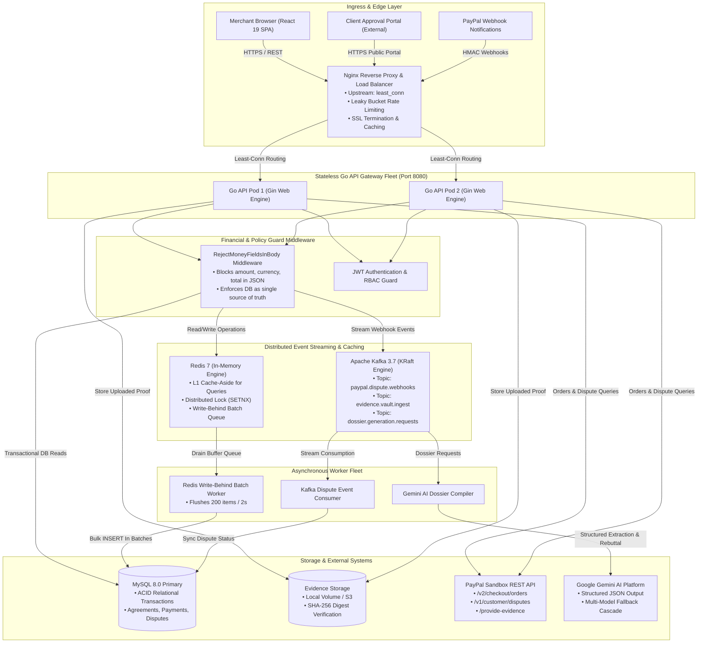
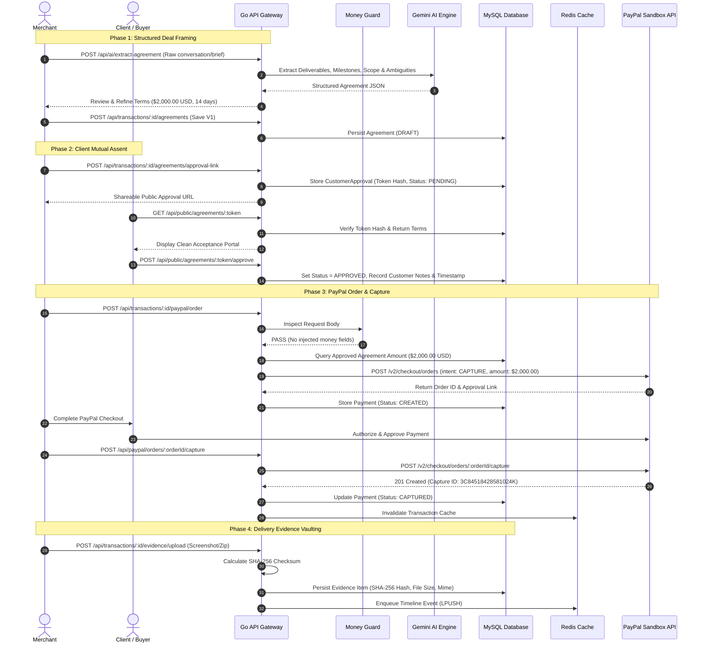
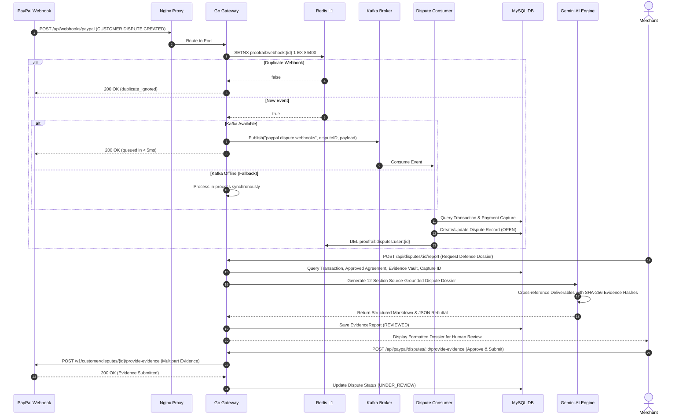

# ProofRail AI — Technical Architecture Specification

> **A Judge-Focused Deep Dive into the Distributed Architecture, Data Lifecycles, Event Pipelines, and Trust Boundaries of ProofRail AI.**

---

## 1. Executive Architectural Overview

ProofRail AI is designed as a **trust layer between business promises and digital payment flows**. In the payment dispute ecosystem, merchants face asymmetric risk: PayPal disputes require strict documentary evidence (contracts, customer acceptance, capture IDs, delivery proof, domain verification) under tight response windows (often 10–20 days).

ProofRail AI replaces post-dispute panic with **continuous evidentiary defense**:
1. **Pre-Dispute Defensibility:** Continuous health auditing and gap analysis *before* work is delivered or disputes arise.
2. **Strict Financial Separation:** AI never moves money or sets financial terms. All amounts, currencies, and capture references originate exclusively from human-approved database records.
3. **High-Throughput Distributed Processing:** Nginx edge load balancing, stateless Go API gateways, Apache Kafka event streaming, Redis L1 caching, and Redis-to-MySQL write-behind batching with zero-downtime graceful fallback.

---

## 2. High-Level System Architecture



---

## 3. Core Component Responsibilities

### 3.1 Edge Layer (Nginx)
* **Configuration:** [`nginx/nginx.conf`](file:///e:/Projects/paypal-hackathon/nginx/nginx.conf)
* **Least-Connection Balancing:** Distributes requests dynamically between `server-1` and `server-2` based on active socket connections.
* **Leaky Bucket Rate Limiting:**
  * `zone=api_general_limit:10m rate=100r/m` (burst=20 nodelay) protects core API routes.
  * `zone=webhook_limit:10m rate=30r/s` (burst=50 nodelay) buffers PayPal webhook bursts.
* **Keep-Alive Pooling:** Reuses persistent HTTP/1.1 connections upstream to backend pods, cutting TCP handshake latency to zero for high-frequency traffic.

### 3.2 Stateless Go API Gateways
* **Configuration:** Built on Gin and Go 1.24+ ([`server/cmd/server/main.go`](file:///e:/Projects/paypal-hackathon/server/cmd/server/main.go)).
* **Stateless Token Authentication:** Uses HMAC-SHA256 JWTs with expiration claims.
* **Zero-Downtime Fallback Architecture:** If Redis or Kafka are unreachable or not yet booted, the gateway automatically falls back to direct synchronous database processing without service interruption.

### 3.3 Security & Financial Guard Middleware
* **Source:** [`server/internal/middleware/guard.go`](file:///e:/Projects/paypal-hackathon/server/internal/middleware/guard.go)
* **Rule:** "AI recommends, backend validates, merchant approves — AI never moves money."
* **Enforcement:** `RejectMoneyFieldsInBody()` inspects all incoming request bodies to payment-related endpoints. If any payload attempts to pass `amount`, `currency`, `currency_code`, `total`, or `value`, the middleware immediately returns `400 Bad Request (SECURITY_POLICY_VIOLATION)`.
* **Single Source of Truth:** All monetary values for PayPal order creation originate strictly from the immutable database row of the customer-approved agreement.

### 3.4 Apache Kafka Event Streaming
* **Source:** [`server/internal/infra/kafka.go`](file:///e:/Projects/paypal-hackathon/server/internal/infra/kafka.go)
* **Engine:** KRaft mode (no ZooKeeper dependency).
* **Topic `paypal.dispute.webhooks`:** Partitioned by `dispute_id` ensuring in-order processing per dispute.
* **Fast Acknowledgement:** Webhook ingress acknowledges PayPal in `< 5ms`, offloading payload verification and dispute record updating to background consumers.

### 3.5 Redis 7 Caching & Write-Behind Batching
* **Source:** [`server/internal/infra/redis.go`](file:///e:/Projects/paypal-hackathon/server/internal/infra/redis.go)
* **Cache-Aside Reads:** Frequently accessed entities (disputes, transactions, agreements) are cached with 30s–60s TTLs.
* **Write-Behind Batching:** High-frequency timeline audit events are buffered in Redis FIFO queues (`LPUSH proofrail:batch:timeline`) and bulk-inserted into MySQL every 2 seconds or 200 items via `db.CreateInBatches()`.
* **Atomic Idempotency:** Webhook IDs are stored via `SETNX proofrail:webhook:{id} 1 EX 86400` to prevent duplicate processing during network retries.

---

## 4. End-to-End Transaction & Evidence Lifecycle



---

## 5. Dispute Resolution & Dossier Flow



---

## 6. Trust Boundary & Financial Policy Isolation

```
       UNTRUSTED ENVIRONMENT (Browser, Client, LLM Prompts)
──────────────────────────────────────────────────────────────────────────
                                  │
                                  ▼
                    [ RejectMoneyFieldsInBody ]
                                  │
                  (Aborts if amount/currency in body)
                                  │
                                  ▼
──────────────────────────────────────────────────────────────────────────
             TRUSTED ENVIRONMENT (GORM Backend & MySQL Master)
                                  │
        ┌─────────────────────────┴─────────────────────────┐
        ▼                                                   ▼
[ Agreements Table ]                              [ Payments Table ]
• Human-approved amount                           • Tied to Agreement ID
• Immutable version record                        • PayPal Capture ID
• Customer token signature                        • Immutable currency
```

1. **No Client Pricing:** The client application never submits payment amounts to order creation endpoints.
2. **No LLM Financial Control:** AI provides suggestions during agreement drafting. Once saved, terms are locked by merchant approval and client token verification.
3. **Traceable Audit Chain:** Every status mutation generates a cryptographically hashed timeline entry linked to an actor (`MERCHANT`, `CUSTOMER`, `PAYPAL`, `AI`, or `SYSTEM`).

