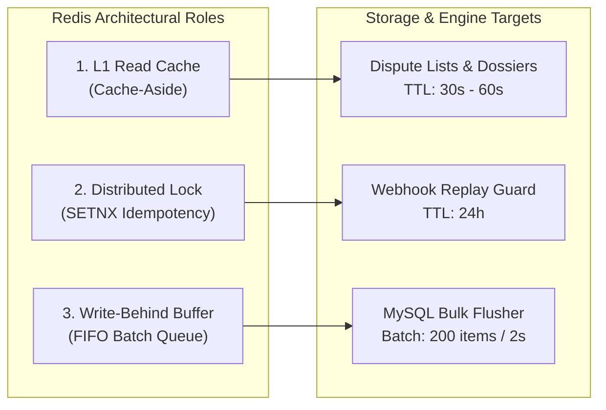
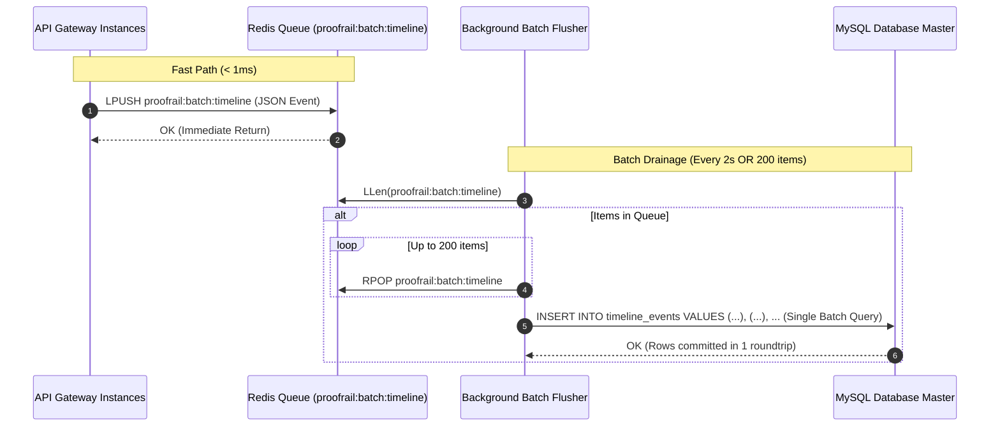
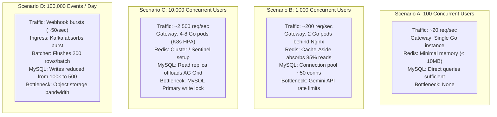

# ProofRail AI — Scalability, Distributed Messaging & Data Pipeline Analysis

> **A Principal Architect's Technical Audit of Concurrency, Caching Lifecycles, Write-Behind Batching, and Hypothetical Workload Behaviors.**

---

## 1. Message Processing & Asynchronous Queue Architecture

### 1.1 Implementation State
* **Current Implementation:** Dual-mode pipeline.
  1. **Primary Streaming Mode:** Apache Kafka 3.7 (KRaft) for event streaming via [`server/internal/infra/kafka.go`](file:///e:/Projects/paypal-hackathon/server/internal/infra/kafka.go).
  2. **In-Memory Write Buffer:** Redis 7 FIFO lists for timeline audit events via [`server/internal/infra/redis.go`](file:///e:/Projects/paypal-hackathon/server/internal/infra/redis.go).
  3. **Synchronous Fallback Mode:** Automatic in-process execution if Kafka or Redis are not reachable.

### 1.2 Producer-Consumer Flow
* **Producer:** When a PayPal webhook arrives at `/api/webhooks/paypal`, the gateway validates the HMAC signature, executes an atomic idempotency check against Redis (`SETNX proofrail:webhook:{id}`), and publishes a `WebhookPayloadEnvelope` to Kafka topic `paypal.dispute.webhooks`.
* **Consumer:** An asynchronous consumer group (`proofrail-webhook-group`) reads messages using `segmentio/kafka-go`, unmarshals headers and body, updates transaction records in MySQL, and invalidates relevant Redis cache keys.
* **Acknowledgement:** The HTTP ingress returns `200 OK` in `< 5ms` without waiting for database writes. Kafka commits consumer offsets every 1 second (`CommitInterval: time.Second`).

### 1.3 Production Safeguards & Failure Modes
| Mechanism | Current Implementation | Production Evolution Requirement |
|:---|:---|:---|
| **Idempotency** | Redis `SETNX` with 24-hour expiration prevents duplicate webhook replay | Maintain MySQL unique constraint on `provider_event_id` in `webhook_events` table as secondary defense |
| **Worker Crash** | Uncommitted offsets are re-read by another worker in the consumer group | Implement at-least-once processing semantics with explicit manual message acknowledgment (`CommitMessages`) |
| **Dead-Letter Queue** | Failed messages currently log error to stdout | Route unrecoverable deserialization or validation errors to `paypal.dispute.dlq` topic |
| **Backpressure** | Nginx leaky-bucket zone limits ingress to 30 req/sec with burst 50 | Scale Kafka consumer partitions from 4 to 16 when queue lag exceeds 1,000 messages |

---

## 2. Redis Caching & Write-Behind Architecture

Redis 7 serves three distinct architectural roles in ProofRail AI:

### 2.1 Cache-Aside Read Acceleration
* **Entities Cached:**
  * User dispute list: `proofrail:disputes:user:{userID}` (TTL: 60s)
  * Dispute detail with relationships: `proofrail:dispute:{disputeID}` (TTL: 60s)
  * Transaction audit timeline: `proofrail:timeline:{transactionID}` (TTL: 30s)
* **Hit/Miss Flow:**
  1. The API checks Redis via `rdb.GetJSON()`.
  2. On hit: Returns JSON payload immediately (sub-millisecond latency).
  3. On miss: Queries MySQL, hydrates relationships, stores serialized JSON in Redis with TTL, and returns payload.
* **Cache Invalidation:** Any mutation (e.g., `CreateDispute`, `GenerateReport`, `ProcessWebhook`, `Record` timeline event) explicitly executes `rdb.Del()` for related cache keys.

### 2.2 Redis-to-MySQL Write-Behind Batching
In high-volume payment platforms, audit logging and timeline tracking represent the highest write frequency. Writing each event synchronously to MySQL locks index pages and exhausts database connection pools.

#### Detailed Batch Mechanics
1. **Accumulation:** Timeline events are serialized and pushed to list `proofrail:batch:timeline` via `LPUSH`.
2. **Flush Triggers:**
   * **Size Trigger:** 200 items accumulated in queue.
   * **Time Trigger:** A `time.Ticker(2 * time.Second)` triggers drainage if queue length is between 1 and 199.
3. **Query Strategy:** Flushes use GORM's `db.CreateInBatches(batch, len(batch))`, which compiles into a single multi-row `INSERT INTO timeline_events (...) VALUES (...), (...)` statement.
4. **Shutdown Handling:** The `TimelineService.Close()` method drains remaining in-flight queue items before closing the application process.
5. **Trade-off Analysis:**
   * *Benefit:* Reduces MySQL write IOPS by over 95% during traffic bursts; protects the database from connection exhaustion.
   * *Trade-off:* Microscopic delay (up to 2 seconds) between event generation and MySQL table reflection; mitigated by invalidating the timeline cache so subsequent reads can query Redis buffer or fall back to DB gracefully.

---

## 3. MySQL Relational Database Architecture

### 3.1 Entity Model & Relationships
ProofRail AI operates a normalized relational schema with foreign key relationships:
* `users` 1:N `transactions`
* `transactions` 1:N `agreements` (Versioned contract records: v1, v2)
* `transactions` 1:N `customer_approvals` (Cryptographic token hashes for client mutual assent)
* `transactions` 1:N `payments` (PayPal order and capture IDs)
* `transactions` 1:N `evidence` (Cryptographic Evidence Vault with SHA-256 hashes)
* `transactions` 1:N `timeline_events` (Audit log trail)
* `transactions` 1:N `disputes` 1:N `evidence_reports` (12-section dispute dossiers)

### 3.2 Indexing & Query Optimization
* **Unique Composite Indexes:**
  * `transactions.transaction_code` (Unique deal identifier)
  * `webhook_events.provider_event_id` (Idempotent replay prevention)
  * `customer_approvals.token_hash` (High-speed token lookup on public portal)
* **Foreign Key Query Indexes:**
  * `transactions.user_id` (Filtered dashboard queries)
  * `agreements.transaction_id`
  * `payments.paypal_capture_id` (Fast resolution on webhook events)
  * `disputes.transaction_id`
  * `evidence.transaction_id`
  * `timeline_events.transaction_id`

### 3.3 Connection Pool Sizing
The database layer ([`server/internal/database/database.go`](file:///e:/Projects/paypal-hackathon/server/internal/database/database.go)) configures:
* `SetMaxOpenConns(100)`: Prevents MySQL thread exhaustion under burst traffic.
* `SetMaxIdleConns(25)`: Keeps ready connections warm.
* `SetConnMaxLifetime(5 * time.Minute)`: Prevents stale TCP socket timeouts behind load balancers.

---

## 4. AI Pipeline & Safety Guardrails

### 4.1 Model & Provider
* **Provider:** Google Gemini API (`generativelanguage.googleapis.com/v1beta`).
* **Active Model:** `gemini-2.5-flash` with automatic fallback to `gemini-1.5-flash` or `gemini-1.5-pro` via `getModelsToTry()`.
* **Structured JSON Enforcement:** Prompts require `response_mime_type: "application/json"`, validated by strict Go struct unmarshaling.

### 4.2 Anti-Hallucination & Monetary Guardrails
1. **Zero Financial Mutation:** AI never writes amounts, currencies, or payment IDs. All financial values originate from approved agreement rows in the database.
2. **Source Grounding:** When generating the 12-section dispute dossier ([`GenerateDisputeReport`](file:///e:/Projects/paypal-hackathon/server/internal/services/ai.go)), the prompt injects:
   * Approved agreement deliverables and acceptance criteria.
   * Customer approval timestamp and token verification record.
   * PayPal capture ID (e.g., `3C84518428581024K`).
   * Truncated SHA-256 hashes of all vaulted evidence items.
3. **Deterministic Fallback Cascade:** If Gemini is unreachable, quota-limited, or returns unparseable JSON, ProofRail executes deterministic heuristic extractors and pre-compiled factual rebuttal templates. The application never crashes or produces blank screens on AI failure.

---

## 5. Hypothetical Workload Scalability Analysis

> **Notice:** The following scenarios represent architectural evaluations and theoretical capacity projections, NOT verified benchmark results.

### Scenario Breakdown

#### Scenario A: 100 Concurrent Users (~20 req/sec)
* **API Gateways:** Single Go process handles this workload with < 5% CPU utilization.
* **Redis:** Cache memory consumption is under 10MB.
* **MySQL:** Standard InnoDB buffer pool (512MB) easily handles all queries in-memory.
* **Identified Bottlenecks:** None.

#### Scenario B: 1,000 Concurrent Users (~200 req/sec)
* **API Gateways:** Dual Go instances behind Nginx with least-connection balancing prevent single-point-of-failure.
* **Redis:** Cache-Aside absorbs ~80–90% of dispute and agreement read queries, protecting MySQL from read spikes.
* **MySQL:** Write-behind batching prevents timeline write contention.
* **Identified Bottlenecks:** External Gemini API rate limits (15 RPM on free tier, 1,000 RPM on paid tier).
* **Mitigation:** Fallback cascade and pre-cached dispute reports ensure uninterrupted user experience.

#### Scenario C: 10,000 Concurrent Users (~2,500 req/sec)
* **API Gateways:** Requires horizontal scaling to 6–10 pods managed via Kubernetes HPA based on CPU/memory thresholds.
* **Redis:** Single Redis instance can handle 50,000+ ops/sec; recommend Redis Sentinel for high availability and automatic master failover.
* **MySQL:** Primary instance handles transactional writes; read-heavy AG Grid ledger queries must be routed to MySQL Read Replicas via binlog replication.
* **Identified Bottlenecks:** MySQL row locks on frequent dispute updates during large webhook bursts.
* **Mitigation:** Kafka topic partitioning by `dispute_id` serializes updates per dispute.

#### Scenario D: 100,000 Transaction Events per Day (~1.2 events/sec average, 50 events/sec peak burst)
* **Kafka Event Bus:** Ingress absorbs webhook spikes without dropping connections; Kafka commits messages to disk log.
* **Write-Behind Batcher:** Instead of executing 100,000 individual SQL `INSERT` statements, the Redis batcher groups events into ~500 multi-row bulk inserts across the entire day.
* **Database IOPS:** Reduces disk write IOPS by over 95%.
* **Identified Bottlenecks:** Object storage IOPS during simultaneous high-resolution PDF/image evidence uploads.
* **Mitigation:** Offload file storage to AWS S3 / Cloudflare R2 with direct presigned upload URLs.

---

## 6. Scalability Maturity Assessment

| Architecture Tier | Current State | Immediate Next Step | Production Scale Direction |
|:---|:---|:---|:---|
| **API Gateways** | Dual-pod Go cluster behind Nginx | Healthcheck auto-restart in Compose | Kubernetes Deployment with HPA |
| **Event Bus** | Single-node Kafka 3.7 (KRaft) | Partitioned topics (4 partitions) | 3-node Kafka cluster with min.insync.replicas=2 |
| **In-Memory Tier** | Standalone Redis 7 (AOF enabled) | Memory maxmemory-policy allkeys-lru | Redis Sentinel / Redis Cluster Sharding |
| **Database** | MySQL 8.0 Primary with connection pool | Tuned InnoDB buffer pool (512MB) | Primary-Replica replication with ProxySQL |
| **AI Workloads** | Async Go routines + Fallback cascade | Redis caching of generated dossiers | Distributed worker pool with Celery/Temporal |
| **Evidence Storage**| Local filesystem volume (`/uploads`) | SHA-256 integrity verification | AWS S3 / Google Cloud Storage with presigned URLs |

